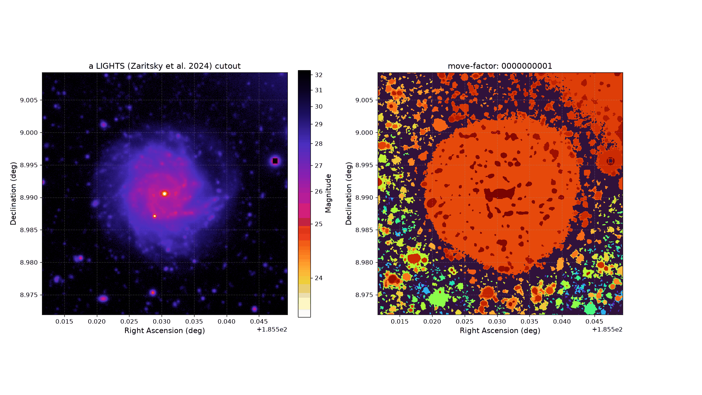

# MTO2
[](https://rustup.rs)[](https://doi.org/10.33612/diss.1475192919)

Max-tree based source detection and segmentation for ultra-deep astronomical images.

MTO2 builds a max-tree over the image, estimates a flat or morphological background from
the image, detects significant nodes statistically, refines segment
boundaries with isophote correction, and writes segmentation maps, a binary
mask, and a per-object catalogue.

---

## Installation

### Prerequisites

- **Rust ≥ 1.100** — install via [rustup](https://rustup.rs):
  ```bash
  curl --proto '=https' --tlsv1.2 -sSf https://sh.rustup.rs | sh
  ```
- **cfitsio** development headers (required by the `fitsio` crate).

### Linux

**Debian / Ubuntu**
```bash
sudo apt update
sudo apt install -y build-essential pkg-config libcfitsio-dev
```

**Fedora / RHEL**
```bash
sudo dnf install -y gcc make pkgconfig cfitsio-devel
```

**Arch**
```bash
sudo pacman -S --needed base-devel cfitsio
```

### macOS

```bash
xcode-select --install          # C toolchain
brew install cfitsio rustup-init
rustup-init -y
```

### Build

```bash
git clone https://github.com/m-faezi/MTO2 MTO2
cd MTO2
cargo build --release
```

Binary: `target/release/mto2`

### Install as a system command (optional)

```bash
cargo install --path .
# now `mto2` is on your PATH
```

---

## Usage

```bash
mto2 <image.fits> [options]
```

### Options

| Flag               | Default     | Meaning                                      |
|--------------------|-------------|----------------------------------------------|
| `--hdu N`          | `0`         | FITS HDU index                               |
| `--conn 4\|8`      | `4`         | Max-tree connectivity                        |
| `--s-sigma F`      | `2.0`       | Gaussian smoothing sigma (`0` = no smoothing)|
| `--move-factor F`  | `0.0`       | Isophote refinement factor                   |
| `--alpha F`        | `1e-6`      | Significance level                           |
| `--area-ratio F`   | `0.90`      | Isophote area ratio                          |
| `--rejection-rate` | `0.05`      | Flat-tile rejection rate                     |
| `--out-dir DIR`    | timestamped | Output directory under `results/`            |



### Examples

Basic run:
```bash
mto2 image.fits
```

Eight-connectivity, named output directory:
```bash
mto2 image.fits --conn 8 --out-dir run_8conn
```

Skip smoothing and use a stricter significance threshold:
```bash
mto2 image.fits --s-sigma 0 --alpha 1e-8
```

Via cargo (no install step):
```bash
cargo run --release -- image.fits --conn 8
```

### Outputs

Everything is written to `results/<out-dir or run_<timestamp>>/`:

| File | Content |
|------|---------|
| `volume_vs_area_hdu<N>_<Conn>.svg` | Log-log area vs. volume scatter of tree nodes |
| `segmentation_hdu<N>_<Conn>_s<..>_mf<..>_ar<..>.svg` | Colour-coded segmentation map |
| `segmentation_map.fits` | int32 map: `0` = background, `1..K` = segment id |
| `binary_mask.fits` | uint8 mask: `0` = background, `1` = any segment |
| `parameters.csv` | `ID,Area,Flux,R_eff,Min,Max,X,Y,RA,Dec` per segment |

`parameters.csv` columns:

- **Area** — tree-node area (pixels, includes nested segments)
- **Flux** — sum of the *unsmoothed* image over the segment's pixels
- **R_eff** — effective radius from pixel moments
- **Min / Max** — extrema of the unsmoothed image over the segment
- **X / Y** — pixel centroid
- **RA / Dec** — world coordinates from the FITS WCS (NaN if absent)

---

## Quick start (one block)

```bash
# Linux (Debian/Ubuntu)
sudo apt install -y build-essential pkg-config libcfitsio-dev
curl --proto '=https' --tlsv1.2 -sSf https://sh.rustup.rs | sh -s -- -y
source "$HOME/.cargo/env"
git clone https://github.com/m-faezi/MTO2 MTO2 && cd MTO2
cargo build --release
./target/release/mto2 image.fits --conn 8 --out-dir first_run
```

```bash
# macOS
xcode-select --install
brew install cfitsio
curl --proto '=https' --tlsv1.2 -sSf https://sh.rustup.rs | sh -s -- -y
source "$HOME/.cargo/env"
git clone https://github.com/m-faezi/MTO2 MTO2 && cd MTO2
cargo build --release
./target/release/mto2 image.fits --conn 8 --out-dir first_run
```

---

## Project layout

```
MTO2/
├── Cargo.toml
├── src/
│   ├── main.rs                # CLI + pipeline orchestration
│   ├── lib.rs                 # public module exports
│   ├── maxtree.rs             # max-tree construction + attributes
│   ├── background.rs          # flat-tile background estimator
│   ├── morph_background.rs    # morphological fallback estimator
│   ├── statistical_tests.rs   # significance detection + move_up
│   ├── refined.rs             # refined segmentation
│   ├── segment.rs             # segmentation from contracted tree
│   ├── output.rs              # FITS maps + parameters.csv
│   └── plot.rs                # SVG log-log diagnostic plot

```

---

## Citation

If you use MTO2 in your research, please cite the following paper:

```bibtex
@ARTICLE{10535192,
  author={Hashem Faezi, Mohammad and Peletier, Reynier and Wilkinson, Michael H. F.},
  journal={IEEE Access}, 
  title={Multi-Spectral Source-Segmentation Using Semantically-Informed Max-Trees}, 
  year={2024},
  volume={12},
  number={},
  pages={72288-72302},
  doi={10.1109/ACCESS.2024.3403309}
}
```

## Acknowledgments

This software was developed for **[Faint Object Detection in Multidimensional Astronomical Data](https://research.rug.nl/en/publications/faint-object-detection-in-multidimensional-astronomical-data/)** Ph.D. thesis (Mohammad H. Faezi, 2026) at the Rijksuniversiteit of Groningen under the supervision of Dr. Michael Wilkinson, Prof. Dr. Reynier Peletier and Prof. Dr. Nicolai Petkov.

## License

This project is licensed under the [MIT License](https://opensource.org/license/MIT) - see the [LICENSE](LICENSE) file for details.

